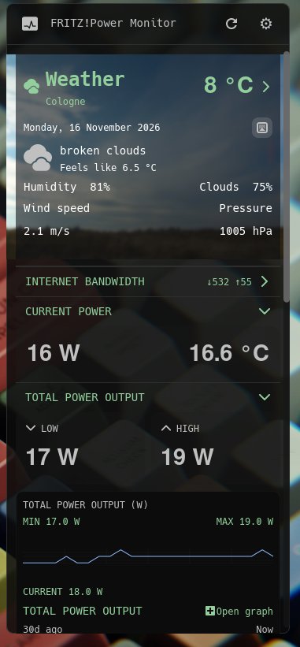
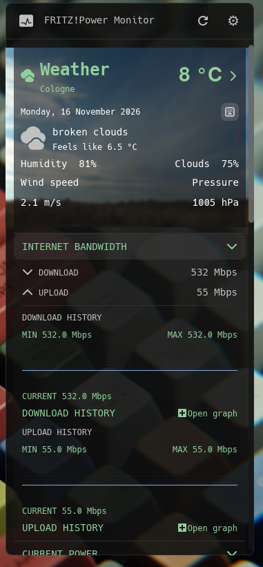

# FRITZ!Power Monitor

<p align="center">
  
</p>

<p align="center"><strong>Power, smart-home devices and weather — right in your COSMIC panel.</strong></p>

<p align="center">
  <a href="https://github.com/gpkvt/cosmic-ext-fritzsmart-monitor-applet/releases/latest"></a>
  <a href="LICENSE"></a>
</p>

<p align="center">
  <a href="https://gpkvt.github.io/cosmic-ext-fritzsmart-monitor-applet/">Website</a> ·
  <a href="https://gpkvt.github.io/cosmic-ext-fritzsmart-monitor-applet/#downloads">Downloads</a> ·
  <a href="https://gpkvt.github.io/cosmic-ext-fritzsmart-monitor-applet/guide.html">User guide</a> ·
  <a href="https://github.com/gpkvt/cosmic-ext-fritzsmart-monitor-applet/issues">Issues</a>
</p>

FRITZ!Power Monitor is an independent, native [COSMIC](https://system76.com/cosmic) panel applet for monitoring compatible FRITZ!Box Smart Home meters, switches, temperature sensors and thermostats, plus Tasmota power meters, controlling supported devices, and viewing optional Philips Hue, Netatmo and weather data. Core power monitoring runs on your local network; **no third-party monitoring account is required**.

<p align="center">
  <a href="docs/Screenshot_2026-11-16_18-17-17.png"></a>
</p>

## Highlights

- **Live power at a glance.** Independent input and output readings (W), device-level graphs and estimated daily energy (Wh). Input power is *not* subtracted from output power.
- **One device list.** Search, reorder, hide, expand and sort connected devices; switch compatible FRITZ!Box, Tasmota and Hue lights.
- **Useful histories.** Collapsible power and sensor graphs, selectable retention, seven-day energy summaries and temperature alerts.
- **More than power.** Temperature from supported devices; Hue light level and motion; Netatmo humidity, CO₂, pressure, noise, rain and wind where supplied. Optional CO₂ threshold notifications for Netatmo modules.
- **COSMIC-native behavior.** Click-to-open panel popup, configurable panel metrics, scrollable details, saved disclosure states and accessible tooltips.
- **Optional outdoor weather.** OpenWeatherMap conditions, outdoor air pollution (1–5 AQI and PM2.5/PM10, NO₂, O₃ concentrations where available), and forecasts with credited Wikimedia Commons imagery. The photo/table section grows to show available readings without a second scrollbar; optional internet upload/download statistics.
- **Independent connections.** An unavailable integration does not have to interrupt the others. Missing or offline sensor values are not presented as fresh measurements.

> **Know the difference:** FRITZ!Box and compatible Tasmota meters supply electricity measurements. Hue lights and Netatmo weather stations **do not** measure watts or contribute to energy totals. Solar/input summaries appear when at least one meter is designated as an input.

## Screenshots

These are real screenshots of the applet.

| Power and devices | Weather |
| :---: | :---: |
| [](docs/Screenshot_2026-11-16_18-17-17.png) | [](docs/Screenshot_2026-11-16_18-17-33.png) |
| **History** | **Settings** |
| [](docs/Screenshot_2026-11-16_18-17-51.png) | [](docs/Screenshot_2026-11-16_18-18-04.png) |

[View the project website and gallery](https://gpkvt.github.io/cosmic-ext-fritzsmart-monitor-applet/)

## Supported integrations

| Integration | What it provides | Connection |
| --- | --- | --- |
| **FRITZ!Box Smart Home** | Device state, power/energy and temperature where supported; switching for compatible devices | Local FRITZ!Box API |
| **Tasmota** | Power readings and supported switching; mDNS discovery and targeted LAN scanning | Local HTTP |
| **Philips Hue Bridge** | Light switching; compatible sensor temperature, illuminance and motion; sensor history | Local CLIP v2 API |
| **Netatmo Weather Stations** | Read-only station/module readings and sensor graphs; no power data | Netatmo cloud HTTPS API, OAuth `read_station` |
| **OpenWeatherMap** | Conditions, outdoor pollutant concentrations and 1–5 air pollution index, plus forecast | Internet API key |
| **Wikimedia Commons** | Attributed, weather-related background images | Internet |

Actual measurements depend on each device and its firmware/API. Hue scenes, dimming, rooms and groups are not implemented. The Netatmo integration is limited to Weather Stations and their supported modules, not thermostats, cameras or other Netatmo product families.

For setup specifics and compatibility limits, use the [user guide](https://gpkvt.github.io/cosmic-ext-fritzsmart-monitor-applet/guide.html).

## Install

**Requirements:** COSMIC Desktop with applet support, plus a reachable FRITZ!Box Smart Home account for core router monitoring. Optional integrations require their corresponding devices and credentials.

### Option A — prebuilt downloads

Get the latest available artifacts on the [downloads page](https://gpkvt.github.io/cosmic-ext-fritzsmart-monitor-applet/#downloads) or [GitHub Releases](https://github.com/gpkvt/cosmic-ext-fritzsmart-monitor-applet/releases). Available release formats may include a portable Linux archive, Debian package, AppImage and Flatpak; inspect the actual release assets before choosing a format.

For the **portable Linux archive**, replace `VERSION` with the release version in its filename:

```bash
tar -xzf fritz-power-monitor-vVERSION-x86_64-unknown-linux-gnu.tar.gz
cd fritz-power-monitor-vVERSION-x86_64-unknown-linux-gnu
install -Dm755 bin/fritz-power-monitor ~/.local/bin/fritz-power-monitor
install -Dm644 share/applications/com.gpkvt.FritzPowerMonitor.desktop ~/.local/share/applications/com.gpkvt.FritzPowerMonitor.desktop
install -Dm644 share/icons/hicolor/scalable/apps/com.gpkvt.FritzPowerMonitor.svg ~/.local/share/icons/hicolor/scalable/apps/com.gpkvt.FritzPowerMonitor.svg
```

The Debian package instead installs its files system-wide. Depending on the install context, it may create user-local symlinks; it does not replace unrelated files. Use the [installation guide](https://gpkvt.github.io/cosmic-ext-fritzsmart-monitor-applet/guide.html#install) for package-specific details.

### Option B — build from source

Requires Rust/Cargo (Rust 2024 edition), GNU Make and standard install utilities.

```bash
git clone https://github.com/gpkvt/cosmic-ext-fritzsmart-monitor-applet.git
cd cosmic-ext-fritzsmart-monitor-applet
make install
```

`make install` fast-forwards your current branch, builds a release binary, installs the applet for the current user and reloads COSMIC Panel. To install without pulling remote changes, use `make install UPDATE=0`. To compile without installing, use `make build`.

**After installing:** open **COSMIC Settings → Desktop → Panel → Configure panel applets** (labels depend on COSMIC version), then add **FRITZ!Power Monitor**. Reopen COSMIC Settings or log out and back in if it is not listed immediately.

## First launch

1. Open the applet's **Settings → Connection** and enter your FRITZ!Box URL and authorized Smart Home account credentials.
2. Choose **Load devices**, select visible devices in **Settings → Devices**, and designate any solar/production meter as an **Input device**.
3. Customize panel readings, popup sections, graphs, refresh rates and temperature notifications.
4. Optionally pair a local Hue Bridge, discover Tasmota devices, connect Netatmo or enable OpenWeatherMap. Each integration can be configured separately.

The panel menu opens on **click**, not hover, and closes when clicked outside or toggled from the panel entry. No separate close button is required.

**Prometheus exporter:** Under **Settings → Connection → Prometheus exporter**, enable **Enable /metrics endpoint** and choose a **Bind address (IP:port)**. The default is `127.0.0.1:9817` (local only; exporter disabled by default). To allow a Prometheus server on your LAN or in Docker to connect, explicitly bind a specific local-interface address such as `192.168.1.10:9817` or all IPv4 interfaces with `0.0.0.0:9817`. IPv6 literals are supported in bracketed notation, for example `[::1]:9817`. Changes apply without restarting the applet; the old listener is closed before rebinding, and invalid addresses never create an exposed listener. Prometheus text exposition includes FRITZ!Box/Tasmota device watts, temperatures, switches, separate input/output totals, selected and inactive device status; Hue lights/sensors; Netatmo weather modules/CO₂ and alert thresholds; OpenWeatherMap conditions; WAN bandwidth/capacity; router uptime and integration availability. Missing measurements are omitted, not converted to 0. Each scrape reads a cached snapshot and **does not send any router, Hue, weather or Netatmo requests**. Labels include local device names and identifiers. The HTTP endpoint has **no authentication or TLS**; on non-loopback addresses, only allow trusted clients using your firewall. Example same-host Prometheus scrape config:

```yaml
scrape_configs:
  - job_name: fritz_power_monitor
    static_configs:
      - targets: ['127.0.0.1:9817']
```

When Prometheus runs in Docker or on another machine, `127.0.0.1` refers to that service, not the desktop applet. For remote scraping, bind to the applet machine's trusted LAN IP (or `0.0.0.0`), then set the scrape target to that machine's **actual reachable IP and selected port**, not `0.0.0.0`. Limit inbound access to your Prometheus host through a firewall or authenticated proxy; never make this unauthenticated endpoint internet-facing. Prometheus stores historical samples itself; this endpoint exports only the latest applet readings, not the saved graph history. The bind address is stored as `PROMETHEUS_BIND_ADDRESS` in `~/.config/fritz_solar.cfg`.

**Outdoor air pollution:** The Weather section also shows outdoor air quality data from OpenWeatherMap where the configured weather location supports it: AQI on OpenWeatherMap's 1–5 scale, plus PM2.5, PM10, NO₂ and O₃ in µg/m³. These are location-based air pollution estimates, **not** measurements from Netatmo's hardware and **not** CO₂ concentrations in ppm. Netatmo's app obtains its outdoor AQI from a separate third-party provider; that data is not available through the station's `read_station` sensor API. If the air pollution service is unavailable, regular weather continues to work.

**Optional Netatmo weather details:** Under **Settings → Weather**, enable **Show additional Netatmo weather readings** to add CO₂-based air quality (Good / Moderate / Elevated / Very high, with measured ppm), sound level (dB), and rainfall (mm) to the Weather details, each labeled with its Netatmo module. It is off by default; only visible, reachable modules contribute, and humidity, wind and pressure are not duplicated from OpenWeatherMap.

**CO₂ notifications:** In **Settings → Devices**, a Netatmo module with CO₂ measurements exposes a toggle and an adjustable high threshold (600–5,000 ppm; default 1,200 ppm). Alerts are disabled by default, notify only when a valid reading rises from safe to above the limit, and re-arm after returning to the safe range. Missing or stale readings do not notify. Threshold changes reset the alarm baseline.

**Outdoor temperature source:** In **Settings → Devices**, enable **Outdoor temperature source** on a Netatmo outdoor module (NAModule1) or a supported FRITZ!Box temperature device. Only one source can be active. The selected live value replaces the OpenWeatherMap temperature in the panel and Weather heading. If the source becomes unavailable, the OpenWeatherMap reading is used instead.

[Detailed first-time setup](https://gpkvt.github.io/cosmic-ext-fritzsmart-monitor-applet/guide.html#first-launch)

## Headless mode (no COSMIC desktop required)

Run the installed binary without a panel, Wayland session or graphical display. Headless mode polls the saved FRITZ!Box/Tasmota devices, connected Hue Bridge, Netatmo stations and optional OpenWeatherMap data independently, and serves their latest available measurements through the same Prometheus exporter. It skips weather photographs and does not launch COSMIC.

Configure devices and credentials once in the applet settings (saved in `~/.config/fritz_solar.cfg`). Then, for a local Prometheus endpoint, run:

```bash
fritz-power-monitor --headless --listen 127.0.0.1:9817
curl -fsS http://127.0.0.1:9817/metrics
```

Alternatively, `fritz-power-monitor --headless` uses the exporter setting and bind address saved in **Settings → Connection**; the exporter must already be enabled. The `--listen IP:PORT` option enables the exporter for that run without changing saved settings. With no options, the executable starts the normal COSMIC applet as before. Use `--help` to see all switches.

For unattended startup on a systemd-based desktop, an **optional user service** is supplied with the Debian package, the portable archive and `make install`. If you installed the portable archive manually, copy `share/systemd/user/fritz-power-monitor-headless.service` to `~/.config/systemd/user/` and adjust `ExecStart` to the installed binary. Then:

```bash
systemctl --user daemon-reload
systemctl --user enable --now fritz-power-monitor-headless.service
systemctl --user status fritz-power-monitor-headless.service
```

The service is **not enabled automatically**. Avoid running the panel exporter and the headless exporter on the same IP/port. To stop it, run `systemctl --user disable --now fritz-power-monitor-headless.service`. Headless monitoring requires a running user service session; `loginctl enable-linger "$USER"` is optional if you need it to continue after logout.

**Security:** The exporter has no authentication or TLS. The default `127.0.0.1` binding is local only. Bind to a LAN interface only if access is restricted. Netatmo OAuth refresh tokens may be updated in the saved configuration during headless operation. The process needs normal user access to its settings and network; root is not required. Headless mode exports current readings, not the interactive panel UI or its graphs and notifications.

## Privacy and security

**Local by default for power monitoring.** FRITZ!Box, Tasmota and Hue operate on the local network. Netatmo, OpenWeatherMap and Wikimedia Commons require external requests only when their respective integrations are enabled.

- Settings and secrets are kept in the user's configuration (`~/.config/fritz_solar.cfg`); graph samples are stored under `~/.local/share/fritz-power-monitor/`.
- FRITZ!Box HTTPS validates certificates by default. **Allow invalid TLS certificates (FRITZ!Box only)** appears beside the trusted CA certificate field in **Settings → Connection**. It affects only the FRITZ!Box client; prefer adding a trusted CA to disabling verification.
- **Hue TLS caveat:** The Hue-specific HTTPS client does not currently validate the Bridge's certificate chain or hostname, and some older bridges may use HTTP for pairing. Pair only on a trusted LAN.
- Netatmo requires a developer client ID, client secret and refresh token with `read_station` permission. Refresh tokens may rotate automatically. Treat credentials as private.
- Never paste configuration files, tokens, router passwords or unredacted diagnostics into a public issue.

Read [SECURITY.md](SECURITY.md) for security boundaries, reporting guidance and current upstream dependency advisories.

## Troubleshooting

| Symptom | First check |
| --- | --- |
| Applet missing from panel settings | Confirm the desktop entry was installed; reopen COSMIC Settings or relog |
| Applet disappears after loading | Reinstall **both** the binary and desktop entry; an old `X-CosmicHoverPopup` entry can cause unexpected synthetic hover clicks |
| FRITZ!Box connection error | Check URL, authorized Smart Home account, certificate hostname and configured CA |
| Missing wattage or temperature | Check whether the physical device exposes that measurement; missing is not zero |
| Hue bridge not found | Rescan via mDNS or enter its private IP; press the bridge link button during pairing |
| Netatmo readings missing | Verify Internet connectivity and OAuth `read_station` scope |
| Weather unavailable | Check OpenWeatherMap API key and location; core power monitoring remains independent |

For a disappearing applet, collect privacy-conscious diagnostics:

```bash
journalctl -b -t fritz-power-monitor -p debug -n 120 --no-pager
pgrep -af 'fritz-power-monitor|cosmic-panel'
```

The known COSMIC hover-popup/size regression was corrected in v2.0.45, but an outdated local desktop entry can override a newer system installation. See the [troubleshooting guide](https://gpkvt.github.io/cosmic-ext-fritzsmart-monitor-applet/guide.html#troubleshooting) before sharing logs.

For updates and help, see [release notes](CHANGELOG.md), the [user guide](https://gpkvt.github.io/cosmic-ext-fritzsmart-monitor-applet/guide.html), and [report an issue](https://github.com/gpkvt/cosmic-ext-fritzsmart-monitor-applet/issues). Include relevant versions and redacted diagnostics when reporting a problem.

## License and trademarks

Licensed under the [MIT License](LICENSE). FRITZ!Power Monitor is a community project **not affiliated with, sponsored, approved or endorsed by FRITZ! GmbH, Philips Hue, Netatmo or their manufacturers**. FRITZ!, FRITZ!Box, Philips Hue, Netatmo and related names are trademarks of their respective owners and are used solely to identify compatibility.
