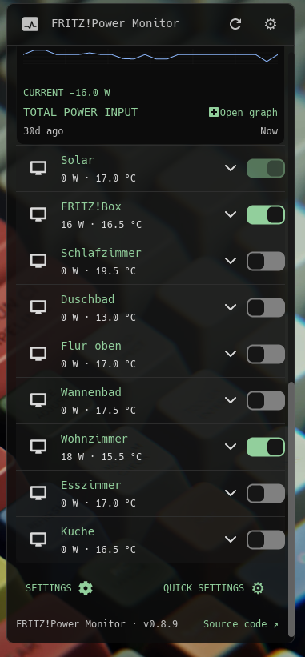

# FRITZ!Power Monitor

A native COSMIC panel applet for monitoring power, temperature and optional weather data from FRITZ!Box Smart Home devices.

FRITZ!Power Monitor connects directly to your router. It brings household power readings, device status and historical graphs into the COSMIC desktop without requiring an external monitoring service.

<p align="center">
  
</p>

<p align="center">
  <a href="https://github.com/gpkvt/cosmic-ext-fritzsmart-monitor-applet/releases">Downloads</a> ·
  <a href="https://github.com/gpkvt/cosmic-ext-fritzsmart-monitor-applet/issues">Report a problem</a> ·
  <a href="https://github.com/gpkvt/cosmic-ext-fritzsmart-monitor-applet/blob/main/LICENSE">MIT license</a>
</p>

## At a glance

- Live power and temperature readings from selected FRITZ!Box Smart Home devices.
- Separate power input, output and net-difference summaries, with device-level history.
- Optional internet download and upload rates in the COSMIC panel.
- Optional OpenWeatherMap conditions, forecast and weather-matched Wikimedia Commons imagery.
- Configurable refresh intervals, graph retention, panel display and popup layout.
- Temperature alerts and supported smart-home device switching.
- Interface translations for English, German, Spanish, Dutch, French, Italian, Swedish, Portuguese, Polish, Danish and Norwegian. Untranslated strings fall back to English.

## Screenshots

The screenshots below show the applet in the COSMIC desktop. Open the [screenshot gallery](https://github.com/gpkvt/cosmic-ext-fritzsmart-monitor-applet/tree/main/docs) for the complete set.

| Live overview | Weather |
| --- | --- |
|  |  |
| **Power history** | **Device settings** |
|  |  |

## Installation

### Download a release

Prebuilt Linux x86_64 packages are published on the [GitHub Releases page](https://github.com/gpkvt/cosmic-ext-fritzsmart-monitor-applet/releases).

| Package | Install / launch |
| --- | --- |
| Debian package | `sudo apt install ./fritz-power-monitor_VERSION_amd64.deb` |
| AppImage | `chmod +x fritz-power-monitor-VERSION-x86_64.AppImage && ./fritz-power-monitor-VERSION-x86_64.AppImage` |
| Flatpak bundle | `flatpak install --user ./fritz-power-monitor-VERSION.flatpak` |
| Portable archive | Extract the archive and run the included `bin/fritz-power-monitor` executable. |

Replace `VERSION` with the version in the downloaded filename. Packages are currently built for x86_64 Linux. Check each release for its artifacts and SHA-256 checksums.

The Flatpak bundle can be installed independently of any app-store listing. Availability in a software store depends on publication of the package by that store.

### Build and install from source

**Requirements**

- A COSMIC desktop session with panel applet support.
- Rust and Cargo compatible with the project's Rust 2024 edition and current `libcosmic` Git dependency.
- GNU Make and standard GNU installation utilities.
- A FRITZ!Box with Smart Home support and a user account authorized to access it.

Clone the repository and install:

```sh
git clone https://github.com/gpkvt/cosmic-ext-fritzsmart-monitor-applet.git
cd cosmic-ext-fritzsmart-monitor-applet
make install
```

The default install target updates the checkout with `git pull --ff-only`, builds the optimized executable and installs it for the current user. It then restarts the COSMIC panel so the applet can be reloaded; panel configuration and applet placement are preserved.

To build without updating the checkout first:

```sh
make install UPDATE=0
```

To build only:

```sh
cargo build --release
```

The default user-local installation uses:

| Item | Location |
| --- | --- |
| Executable | `~/.local/bin/fritz-power-monitor` |
| Desktop entry | `~/.local/share/applications/com.gpkvt.FritzPowerMonitor.desktop` |
| Application icon | `~/.local/share/icons/hicolor/scalable/apps/com.gpkvt.FritzPowerMonitor.svg` |

After installation, open **COSMIC Settings → Desktop → Panel** (wording may vary by COSMIC version) and add **FRITZ!Power Monitor** to a panel. If it is not listed immediately, reopen Settings or log out and back in.

To reload the panel manually after a build:

```sh
make reload
```

To remove the user-local installation:

```sh
make uninstall
```

## First-time setup

1. Add **FRITZ!Power Monitor** to a COSMIC panel.
2. Open the applet and choose **Settings**.
3. In **Connection**, enter the FRITZ!Box URL, username and password.
4. Select **Load devices**, then choose the devices to monitor.
5. Configure the panel display, refresh intervals and graph history to suit your setup.

Use a router hostname that resolves on your local network. HTTPS is supported and certificate validation is enabled by default.

## Features and configuration

### Power monitoring

The popup provides a live overview and individual cards for selected devices. Power readings are grouped into independent views:

- **Total power out** — generated/output power.
- **Total power in** — signed input power from devices configured as inputs.
- **Power difference** — the combined net value.

Input devices do not silently alter the output total. Configure the **Input** option for each device according to what it measures. Devices with “solar” in their name are initially suggested as inputs when discovered; manual choices are retained.

Depending on the device and firmware, the popup can also provide a supported power switch. The control is verified against the router and refreshed device state.

### Panel and popup

Panel settings control the displayed text size and optional metrics:

- Show internet download and upload rates separately.
- Show an average temperature across selected devices.
- Exclude devices whose names contain “solar” from that average.
- Optionally combine consumption and solar generation into a net panel value.

The popup sections can be arranged in Settings and collapsed independently. Device cards show their current power and temperature values and can expose individual history graphs.

### Refresh and history

Power monitoring and weather use independent refresh schedules. Power refresh can be configured from 30 seconds to one hour (default: 60 seconds); weather refresh can be configured from 5 to 60 minutes (default: 10 minutes).

Graph history retention is configurable from 5 minutes up to 4 years. Samples are stored locally and restored after restarting the applet. Sampling adapts to the selected retention period and is bounded to keep storage manageable. Graphs visualize recorded readings; they do not calculate daily energy yield or provide forecasts.

History is stored at:

```text
~/.local/share/fritz-power-monitor/history.json
```

### Temperature alerts

Temperature alerts can be enabled per device. Notifications are sent when a reading crosses the configured upper or lower limit. An alert is re-armed after the device returns to the safe range.

### Weather

Weather is optional and requires an [OpenWeatherMap API key](https://openweathermap.org/api).

1. Enable the weather integration in **Weather** settings.
2. Enter the API key.
3. Enter a location as a city name or `latitude,longitude`.
4. Set the independent weather refresh interval.

The weather card can show current conditions, feels-like temperature, humidity, wind, pressure, cloud cover, visibility, sunrise and sunset, and the forecast. Its illustrative background image is selected to match the reported weather condition and is sourced from Wikimedia Commons; it is not a live camera view of the configured location. If image lookup is unavailable, the card falls back to its normal appearance.

Weather is optional. Weather service failures are independent of FRITZ!Box monitoring.

### Connection, TLS and diagnostics

FRITZ!Box login uses the router's challenge-response authentication. HTTPS certificate verification is enabled by default.

For a router using a self-signed certificate, provide its PEM certificate as a trusted CA certificate in **Connection** settings. This adds a trust anchor while retaining certificate-chain and hostname validation. The option to allow invalid certificates is provided for compatibility, but disabling verification is not recommended.

The **Diagnostics** settings category provides connection and device information to help investigate problems. Do not share diagnostic output containing private network details or credentials publicly.

### Language

The interface supports English, German, Spanish, Dutch, French, Italian, Swedish, Portuguese, Polish, Danish and Norwegian. By default, it follows the COSMIC desktop language; an explicit language can also be selected in Settings. Translation coverage is being expanded, and strings not yet translated fall back to English.

## Building release packages

The packaging script builds Debian, AppImage and Flatpak packages on an x86_64 Linux host. Install its required build tools first (including Cargo, curl, dpkg tooling, Flatpak and flatpak-builder, Git, Python 3 with venv support, and desktop-file utilities).

Run:

```sh
APP_VERSION=0.8.35 bash packaging/build-linux-packages.sh
```

The script writes the packages and a `SHA256SUMS` file to `dist/` by default. Set `OUTPUT_DIR` to use another destination. The version shown is an example; use the version you intend to package.

Basic project checks:

```sh
cargo fmt --all -- --check
cargo test
cargo build --release
```

GitHub Actions also runs project checks and packaging-related validation for changes to the repository.

## Data, security and privacy

- Core monitoring communicates directly with the configured FRITZ!Box on your network.
- Router authentication uses the FRITZ!Box challenge-response mechanism.
- HTTPS certificate validation is enabled by default; a custom CA can be configured.
- Router credentials and the optional weather API key are stored in the user's configuration with owner-only permissions.
- Graph history is stored locally in the user's data directory.
- The optional weather integration contacts OpenWeatherMap. Weather imagery is retrieved from Wikimedia Commons.

The applet does not need a third-party cloud service for its core FRITZ!Box monitoring. Keep credentials, API keys, router addresses and diagnostic details private when reporting issues.

## Troubleshooting

**The applet does not appear in COSMIC Settings**

Confirm that the installation completed, then reopen COSMIC Settings or log out and back in. The panel reload target can also restart the running panel:

```sh
make reload
```

**No devices are listed**

Check that the FRITZ!Box URL is reachable, the account is allowed to access Smart Home data, and the router has compatible devices paired. Then use **Load devices** again.

**HTTPS connection fails**

Use a hostname covered by the router certificate. If the router uses a self-signed certificate, configure its PEM certificate as a trusted CA rather than disabling TLS verification.

**A device has no power or temperature value**

The applet can only display measurements exposed by the device and FRITZ!Box firmware. Confirm that the device provides the relevant measurement and inspect the Diagnostics settings.

**Weather is unavailable**

Check the API key, location and network access. Weather is optional and can be disabled without affecting FRITZ!Box monitoring.

## Contributing and support

Bug reports, feature requests and contributions are welcome:

- [Open an issue](https://github.com/gpkvt/cosmic-ext-fritzsmart-monitor-applet/issues)
- [Browse the source](https://github.com/gpkvt/cosmic-ext-fritzsmart-monitor-applet)
- [View releases](https://github.com/gpkvt/cosmic-ext-fritzsmart-monitor-applet/releases)

When reporting a problem, include your COSMIC version, FRITZ!OS version, applet version and relevant diagnostics. Redact passwords, API keys, public IP addresses and other private information.

## License and trademarks

FRITZ!Power Monitor is released under the [MIT License](LICENSE).

This is an independent, community-developed project. It is not affiliated with, sponsored, authorized or endorsed by FRITZ! GmbH. FRITZ!, FRITZ!Box and related marks are trademarks or registered trademarks of their respective owners and are used only to identify compatible products.
