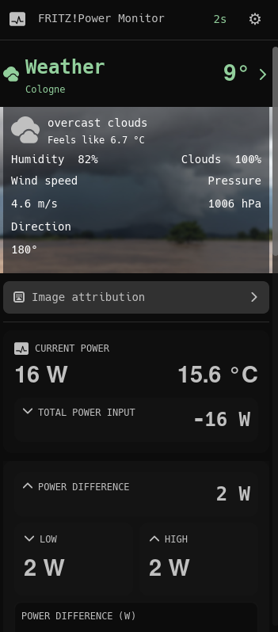

# Cosmic FRITZ!Power Monitor Applet

A native COSMIC panel applet for monitoring live power and temperature readings
from compatible FRITZ!Box Smart Home devices. It communicates with the FRITZ!Box
directly and does **not** execute or depend on `fritz_solar.sh`.



## Contents

- [Features](#features)
- [Requirements](#requirements)
- [Install](#install)
- [Build from source](#build-from-source)
- [Configure the applet](#configure-the-applet)
  - [Panel and device selection](#panel-and-device-selection)
  - [Power inputs and calculations](#power-inputs-and-calculations)
  - [Temperature alerts](#temperature-alerts)
  - [FRITZ!Box connection and TLS](#fritzbox-connection-and-tls)
  - [Weather integration](#weather-integration)
- [History and limitations](#history-and-limitations)
- [Releases and packages](#releases-and-packages)
- [Security and privacy](#security-and-privacy)

## Features

### Live monitoring

- Show live power (W) and temperature readings in the COSMIC panel.
- Monitor multiple selected FRITZ!Box power-meter devices.
- Display each device in its own expandable card with live metrics, a power
  switch when supported, and separate power and temperature history graphs.
- Show total power output, optional input power, and power difference in
  independent summaries and graphs.
- Keep the last successful readings visible when a later refresh fails.
- Skip devices with missing or invalid measurements without discarding readings
  from healthy devices.

### Panel and popup

- Configure panel text size (10–24 pt).
- Show the average temperature across selected devices, with an option to
  exclude devices whose names contain `solar`.
- Reorder popup sections (summary, weather, devices and power overviews) in Settings; the chosen order is saved across restarts.
- Collapse top-level popup sections independently; collapsed headings retain
  their primary live value. Collapsed device rows continue to show power and
  temperature.
- Use the popup's sticky title bar for Refresh and Settings. Its content scrolls
  independently when needed.
- View a live refresh countdown and configure automatic refresh from
  30 seconds to 1 hour (default: 60 seconds).

### Alerts and device controls

- Enable per-device temperature alerts for readings outside configurable
  upper and lower limits. Defaults are 40 °C and −10 °C.
- Receive a notification when a selected device disappears or stops returning
  usable readings. Repeated refreshes do not repeat the same alert; alerts are
  re-armed after recovery.
- Switch compatible devices directly from the popup. The control stays
  disabled while the command is verified and until fresh readings arrive.

### Weather

- Optionally show the current OpenWeatherMap condition icon and temperature in
  the panel, plus a detailed weather card in the popup.
- View feels-like temperature, humidity, wind, pressure, cloud cover,
  visibility, sunrise and sunset.
- Use an illustrative Wikimedia Commons photograph matching the reported
  weather, with attribution and a link to its file-description page.
- Configure an independent 5–60 minute weather refresh interval
  (default: 10 minutes). Weather failures do not interrupt FRITZ!Box readings.

### Connection and diagnostics

- Use FRITZ!Box challenge-response authentication and HTTPS certificate
  validation by default.
- Optionally trust a router-specific PEM CA certificate without disabling
  hostname verification.
- Review connection and device information in the dedicated Diagnostics
  settings category.

## Requirements

- COSMIC desktop session with panel applet support.
- Rust toolchain compatible with the current `libcosmic` Git dependency.
- GNU Make and standard GNU install utilities.
- FRITZ!Box with Smart Home support and at least one device exposing power and
  temperature measurements.
- FRITZ!Box user account permitted to access Smart Home data.

## Install

The recommended user-local installation requires no root privileges:

```sh
make install
```

Run this command from a Git checkout with a configured upstream. The install
target first runs `git pull --ff-only`, then builds and installs the applet.

It installs:

| File | Location |
| --- | --- |
| Executable | `~/.local/bin/fritz-power-monitor` |
| COSMIC desktop entry | `~/.local/share/applications/com.gpkvt.FritzPowerMonitor.desktop` |
| Application icon | `~/.local/share/icons/hicolor/scalable/apps/` |

The desktop entry uses the absolute executable path and includes the COSMIC
applet discovery keys, allowing the applet to appear in COSMIC Settings.

To use a different installation prefix:

```sh
make install PREFIX=/opt/fritz-power-monitor
```

Remove the user-local installation with:

```sh
make uninstall
```

After installation, reopen COSMIC Settings and add **FRITZ!Power Monitor**
from the panel applet list. If it does not appear, log out and back in.

### COSMIC Store (Flatpak)

The Flatpak is being prepared for the official COSMIC Flatpak repository, which
is the distribution channel for COSMIC panel applets. Once the submission is
accepted and published, install it from the COSMIC Store or use:

```sh
flatpak remote-add --if-not-exists --user cosmic https://apt.pop-os.org/cosmic/cosmic.flatpakrepo
flatpak install --user cosmic com.gpkvt.FritzPowerMonitor
```

The submission manifest and its offline Cargo dependency sources are maintained
in `packaging/cosmic-flatpak/`. The standalone `.flatpak` bundle attached to
GitHub releases remains available independently of the COSMIC Store.

## Build from source

Run formatting, tests and an optimized build independently:

```sh
cargo fmt --all -- --check
cargo test
cargo build --release
```

Build all distributable Linux packages (Debian `.deb`, AppImage and Flatpak) with one command on an x86_64 Linux host. The script builds the optimized binary, prepares Flatpak's offline Cargo sources, installs the required Flatpak runtime/SDK, and writes packages plus `SHA256SUMS` to `dist/` by default:

```sh
APP_VERSION=0.3.0 bash packaging/build-linux-packages.sh
```

Override `OUTPUT_DIR` to choose another destination. Required tools include Cargo, curl, dpkg tooling, Flatpak/flatpak-builder, Git, Python 3 with venv support, and desktop-file-utils.

Development builds display the numeric package version (for example, `0.3.0`);
release builds use the version supplied by the release tag.

GitHub Actions runs formatting, tests, compilation, packaging and installation
checks for pull requests and pushes to `main`.

## Configure the applet

Open the applet popup and select **Settings**. Settings are grouped into focused
categories: Panel, Graph history, Automatic refresh, Weather, Connection,
Devices, Menu order and Diagnostics.

### Panel and device selection

1. Set **Panel text size** (10–24 pt).
2. Optionally enable **Show average temperature in panel**. This displays the
   mean temperature across selected devices instead of the first device's
   temperature.
3. If using the average, optionally enable **Exclude solar devices** to omit
   devices whose names contain `solar`.
4. Set the automatic refresh interval (30 seconds to 1 hour; default: 60
   seconds).
5. Enter the FRITZ!Box URL, username and password, then choose **Load devices**.
6. Select the devices to monitor.

Use **Menu order** in Settings to arrange the live power summary, weather, device cards, Total power out, Total power in and Power difference independently. Device cards retain their relative order. Device settings list available devices in the order returned by the FRITZ!Box.
Each selected device appears separately in the popup with its own readings and
history graphs.

### Power inputs and calculations

Enable **Input (subtract from total)** for devices that measure consumption
rather than generation.

- Input wattage is tracked separately as a signed measurement.
- Input wattage does not change **Total power output**.
- **Power difference** combines output with signed input wattage.
- Each input device has its own history graph.
- Devices with `solar` in their name are automatically marked as inputs when
  first discovered. This default is applied only once; manual changes are
  preserved.

### Temperature alerts

Enable **Temperature alerts** for an individual device to receive desktop
notifications when its temperature leaves the configured range.

| Limit | Default | Allowed range |
| --- | ---: | ---: |
| Upper | 40 °C | 0–40 °C |
| Lower | −10 °C | −10–0 °C |

Alerts are disabled by default. A notification is sent when a device crosses
either limit and is re-armed after the temperature returns to the safe range.

### FRITZ!Box connection and TLS

Enter the router URL, username and password in **Connection** settings.
Credentials are stored in `~/.config/fritz_solar.cfg` with owner-only
permissions.

TLS certificate validation is enabled by default. If the router uses a
self-signed certificate, provide its PEM certificate in **Trusted CA
certificate**. The certificate is added as an additional trust anchor; normal
certificate-chain and hostname validation remain enabled.

For example, extract the router certificate with OpenSSL:

```sh
openssl s_client -connect fritz.box:443 -showcerts
```

Save the appropriate PEM certificate in a user-readable file such as
`~/.config/fritzbox-ca.pem`, then enter that path in the applet. Use a URL
hostname present in the certificate's Subject Alternative Name (SAN), such as
`https://fritz.box/`, and ensure it resolves to the local router.

**Allow invalid TLS certificates** is retained for compatibility only. Enabling
it disables certificate verification; keep it off when using a trusted
certificate.

Existing simple `KEY=VALUE` configuration files remain readable. The applet
manages the configuration file.

### Weather integration

Weather is optional and requires an OpenWeatherMap API key.

1. Enable **Use current weather icon**.
2. Enter the API key.
3. Enter a city name or coordinates in `latitude,longitude` format.
4. Choose the independent weather refresh interval (5–60 minutes;
   default: 10 minutes).

When enabled, the panel shows the current weather condition icon and
OpenWeatherMap temperature. The popup includes a detailed summary with
feels-like temperature, humidity, wind speed and direction, pressure, cloud
cover, visibility, sunrise and sunset in local time.

The background photograph is an illustrative Wikimedia Commons image selected
for the reported weather type, not a live camera image of the configured
location. Attribution links to the exact Commons file-description page.
If photo lookup fails, the applet falls back to its normal themed card.
The API key is stored in the owner-only configuration file.

## History and limitations

- Configure graph history retention in Settings from 5 minutes up to 4 years.
  The same retention window controls which samples are shown in graphs. Both
  the saved samples and the selected retention period survive applet restarts.
- Total-power and per-device readings are refreshed normally; history keeps
  the latest reading in an adaptive interval. Sampling automatically becomes
  less frequent for longer retention windows and is capped at about 50,000
  samples per history series.
- The popup shows net-power low/high values, per-device power and temperature
  sparklines, and a separate signed power graph for each input device.
- Sparklines are evenly downsampled to 12 columns to fit their cards.
- Graph samples are stored locally in
  `~/.local/share/fritz-power-monitor/history.json` and restored after restarting
  the applet. The history file is owner-readable only. The configured retention
  window (5 minutes to 4 years) is retained across restarts. Long-term history
  uses adaptive sampling (up to about 50,000 samples per series); it cannot show daily yield, forecasts
  or inverter-specific statistics.
- The FRITZ!Box device must expose both `powermeter/power` and
  `temperature/celsius` in its device XML.

## Releases and packages

Push a version tag such as `v0.3.0` to build Linux x86_64 release packages and
publish them on the GitHub Releases page.

Each release includes SHA-256 checksums and the following artifacts:

| Package | Contents |
| --- | --- |
| Debian `.deb` | Applet, COSMIC desktop entry and icon; runtime dependencies detected from the executable |
| AppImage | Self-contained application with shared-library dependencies bundled |
| Portable `.tar.gz` | Applet binary, desktop entry, icon, README and license |
| Flatpak | Sandboxed COSMIC applet bundle |

The Flatpak uses the Freedesktop 26.08 runtime and Rust SDK extension. It
requests Wayland and network access for FRITZ!Box/OpenWeatherMap connections,
plus desktop-notification permission.

## Security and privacy

- FRITZ!Box authentication uses the challenge-response login mechanism.
- HTTPS certificate validation is enabled by default.
- Router-specific CA certificates can be trusted without disabling hostname
  verification.
- Credentials and the weather API key are stored in a user-owned configuration
  file with owner-only permissions.
- The invalid-certificate option is available for compatibility, but is not
  recommended.

## Project status

This project is an implementation baseline. A successful build and runtime
validation on a COSMIC desktop and against the target FRITZ!Box model and
FRITZ!OS version are required before considering a release fully validated.
