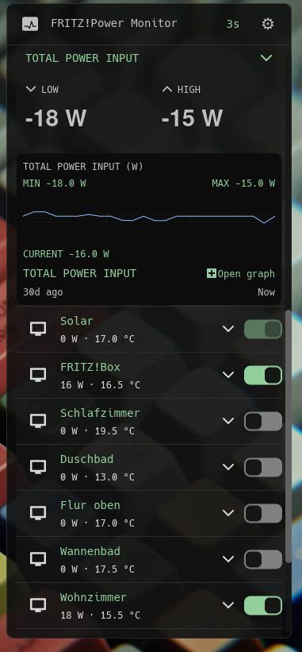

# FRITZ!Power Monitor

A native COSMIC panel applet for monitoring power, temperature and optional weather data from FRITZ!Box Smart Home devices.

FRITZ!Power Monitor connects directly to your router. It brings household power readings, device status and historical graphs into the COSMIC desktop without requiring an external monitoring service.

<p align="center">
  
</p>

<p align="center">
  <a href="https://github.com/gpkvt/cosmic-ext-fritzsmart-monitor-applet/releases">Downloads</a> ·
  <a href="https://github.com/gpkvt/cosmic-ext-fritzsmart-monitor-applet/issues">Report a problem</a> ·
  <a href="https://github.com/gpkvt/cosmic-ext-fritzsmart-monitor-applet/blob/main/LICENSE">MIT license</a>
</p>

## At a glance

- Live power and temperature readings from selected FRITZ!Box Smart Home devices.
- Separate power input, output and net-difference summaries, with device-level history.
- Optional internet download and upload rates in the COSMIC panel.
- Optional OpenWeatherMap conditions, forecast and weather-matched Wikimedia Commons imagery.
- Configurable refresh intervals, graph retention, panel display and popup layout.
- Temperature alerts and supported smart-home device switching.
- Optional local Philips Hue Bridge lights with on/off controls and Hue motion sensors with temperature (°C/°F), ambient light (lux), motion-state readings, collapsible history graphs and per-sensor high/low temperature notifications; Hue devices do not contribute to wattage totals.
- Interface translations for English, German, Spanish, Dutch, French, Italian, Swedish, Portuguese, Polish, Danish, Norwegian, Japanese and Korean. All 121 interface strings are covered; technical names and URLs remain unchanged where appropriate.

## Philips Hue Bridge (optional)

The applet supports Philips Hue Bridges on the local network through the **CLIP v2 API**. This integration is independent of the FRITZ!Box and Tasmota connections.

1. Open **Settings → Connection → Philips Hue Bridge**. The applet looks for local bridges via mDNS and fills in the IP automatically if it finds exactly one. Use **Find Hue Bridge automatically** to rescan, or choose a bridge if several are found.
2. If mDNS cannot find the bridge, enter its **local IP address** from the Hue app or your router, without a scheme or port. Discovery stays on the local network; no Hue cloud lookup is used.
3. Select **Pair Hue Bridge**, then press the physical link button on the bridge (or press the button first). Pairing retries for about 30 seconds while waiting for button authorization. A clear error appears directly below the pairing controls if authorization fails. Alternatively, paste an existing Hue application key into the secure field.
4. Open **Settings → Devices** to manage FRITZ!Box, Tasmota and Hue devices in one searchable list. Discovered Hue lights and sensors have persistent visibility checkboxes and share the saved +/− order controls with power meters; lights can also be switched here. Open **Devices** in the popup to view the same selected Hue devices alongside the metered devices, with temperature (°C/°F), lux and motion details where reported. **Discover devices** also refreshes the paired Hue Bridge; Bridge pairing and credentials remain under **Settings → Connection**.

Hue sensor cards offer independent **Temperature** and **Illuminance** graphs. Only real temperature and lux samples are recorded in a separate `hue-sensors.json` history file; the selected graph time range and °C/°F unit are respected. Each graph can be collapsed independently and its state survives restarts. In **Settings → Devices**, each Hue sensor has optional **Temperature alerts**, with upper/lower threshold sliders and native notifications when valid readings cross a limit. Alerts are off by default and do not trigger on missing or offline measurements. The menu opens on a panel click, closes when clicking outside the popup, and can also be dismissed through its Close button or by clicking the panel entry again. Hovering a panel reading shows a COSMIC tooltip with its device name (or **Average temperature** for averaged readings) over the value only. Hovering does not open the main menu; clicking the panel opens or closes it.

When **Average temperature** is enabled for the panel, valid readings from visible, reachable Hue temperature sensors are included alongside selected FRITZ!Box readings. Sensors without live temperatures are excluded rather than counted as zero. Hue light and sensor readings refresh independently once per minute, as well as on manual refresh and after switching a light. When a bridge is unreachable, its known Hue devices remain listed as unavailable, their stale switch states and sensor readings are cleared, and an error appears without affecting power monitoring. Only private/local bridge IP addresses are accepted.

**Measurements:** Hue lights typically provide switching state, not measured electricity usage. The applet **does not** invent watts or add Hue lights to consumption graphs or energy totals. Temperature, light level and motion are read directly from separate Hue CLIP v2 sensor resources and grouped under each physical sensor; their values are read-only, not used for metered power/energy. Hue scenes, brightness, rooms, sensor configuration and groups are not yet supported.

**Security:** Hue's bridge certificate is signed by the Hue-specific CA and uses the bridge ID as its hostname rather than the configured IP. The Hue-only HTTPS client currently bypasses certificate-chain and hostname validation. On older bridges that do not support HTTPS pairing, the registration request can fall back to HTTP; it transmits only the application name and receives the new key without TLS protection. Connect only on a trusted local network. The FRITZ!Box and other HTTPS clients retain their existing certificate validation. The Hue application key is saved in the existing owner-only configuration file and must be treated as a secret.

## Screenshots

The screenshots below show the applet in the COSMIC desktop. Open the [screenshot gallery](https://github.com/gpkvt/cosmic-ext-fritzsmart-monitor-applet/tree/main/docs) for the complete set.

| Live overview | Weather |
| --- | --- |
|  |  |
| **Power history** | **Device settings** |
|  |  |

## Installation

### Download and install

Download the latest portable `.tar.gz` archive from the [project website](https://gpkvt.github.io/cosmic-ext-fritzsmart-monitor-applet/#downloads). The archive contains the executable, COSMIC desktop entry, application icon, README and license.

Extract it and install the files for your user:

```sh
tar -xzf fritz-power-monitor-vVERSION-x86_64-unknown-linux-gnu.tar.gz
cd fritz-power-monitor-vVERSION-x86_64-unknown-linux-gnu

install -Dm0755 bin/fritz-power-monitor ~/.local/bin/fritz-power-monitor
install -Dm0644 share/applications/com.gpkvt.FritzPowerMonitor.desktop ~/.local/share/applications/com.gpkvt.FritzPowerMonitor.desktop
install -Dm0644 share/icons/hicolor/scalable/apps/com.gpkvt.FritzPowerMonitor.svg ~/.local/share/icons/hicolor/scalable/apps/com.gpkvt.FritzPowerMonitor.svg
```

Replace `VERSION` with the version in the downloaded filename. No root access is needed. Open **COSMIC Settings → Desktop → Panel**, choose **Configure panel applets** or **Add applet**, then add **FRITZ!Power Monitor**. If it is not listed, reopen Settings or log out and back in.

### Debian package

The `.deb` installs the executable, desktop entry and icon in their standard system locations:

- `/usr/bin/fritz-power-monitor`
- `/usr/share/applications/com.gpkvt.FritzPowerMonitor.desktop`
- `/usr/share/icons/hicolor/scalable/apps/com.gpkvt.FritzPowerMonitor.svg`

When installed through `sudo apt install` or a graphical package installer that supplies the invoking user's identity, package setup also creates symlinks to these files in that user's `~/.local` profile. Existing files or unrelated symlinks are never overwritten. Removing the package removes only profile symlinks that still point to the package's system files.

If the package manager does not expose the installing desktop user (for example, installation from a root shell), the system-wide entries remain available and no home directory is guessed or modified.

### Build and install from source

**Requirements**

- A COSMIC desktop session with panel applet support.
- Rust and Cargo compatible with the project's Rust 2024 edition and current `libcosmic` Git dependency.
- GNU Make and standard GNU installation utilities.
- A FRITZ!Box with Smart Home support and a user account authorized to access it.

Clone the repository and install:

```sh
git clone https://github.com/gpkvt/cosmic-ext-fritzsmart-monitor-applet.git
cd cosmic-ext-fritzsmart-monitor-applet
make install
```

The default install target updates the checkout with `git pull --ff-only`, builds the optimized executable and installs it for the current user. It then restarts the COSMIC panel so the applet can be reloaded; panel configuration and applet placement are preserved.

To build without updating the checkout first:

```sh
make install UPDATE=0
```

To build only:

```sh
cargo build --release
```

The default user-local installation uses:

| Item | Location |
| --- | --- |
| Executable | `~/.local/bin/fritz-power-monitor` |
| Desktop entry | `~/.local/share/applications/com.gpkvt.FritzPowerMonitor.desktop` |
| Application icon | `~/.local/share/icons/hicolor/scalable/apps/com.gpkvt.FritzPowerMonitor.svg` |

After installation, open **COSMIC Settings → Desktop → Panel** (wording may vary by COSMIC version) and add **FRITZ!Power Monitor** to a panel. If it is not listed immediately, reopen Settings or log out and back in.

To reload the panel manually after a build:

```sh
make reload
```

To remove the user-local installation:

```sh
make uninstall
```

## First-time setup

1. Add **FRITZ!Power Monitor** to a COSMIC panel.
2. Open the applet and choose **Settings**.
3. In **Connection**, enter the FRITZ!Box URL, username and password.
4. Select **Load devices**, then choose the devices to monitor.
5. Configure the panel display, refresh intervals and graph history to suit your setup.

Use a router hostname that resolves on your local network. HTTPS is supported and certificate validation is enabled by default.

## Features and configuration

### Power monitoring

The popup provides a live overview and individual cards for selected devices. Power readings are grouped into independent views:

- **Total power output** — current output power and its recorded history.
- **Total power input** — current input power and its recorded history, shown alongside output in the **Current Power History** graph. The separate **Total Power Input & Output** section combines the large daily IN/OUT/percentage readings, input/output LOW/HIGH/NOW values, and individual full-width input and output power-history graphs. Each of the five graphs—output watts, input watts, daily input Wh, daily output Wh, and daily input/output percentage—can be collapsed separately using its own chevron. The state is remembered after restarting and is independent of the entire section's collapse state. Input-related tiles remain visible if a configured input device disconnects; missing history is displayed as `— W`, not zero. When no input device is configured, the popup uses output-only summaries and graphs. Mark any FRITZ!Box or Tasmota device as an **Input device** under Settings → Devices to reveal input/solar features. Power-only device history is preserved across restarts even if the device does not provide temperature readings.
- **Today and yesterday** — two rows of three large values: input energy (Wh), output energy (Wh), and the input/output percentage. Missing readings display a dash, not a zero.

Input and output totals are displayed independently; the applet does not subtract one from the other in the shared overview. Set each device's **Input** option according to what it measures. Devices with “solar” in their name are initially suggested as inputs when discovered; manual choices are retained.

Depending on the device and firmware, the popup can also provide a supported power switch. The control is verified against the router and refreshed device state.

### Panel and popup

Panel settings control the displayed text size and optional metrics:

- Show internet download and upload rates separately.
- Show an average temperature across selected devices.
- Exclude devices whose names contain “solar” from that average.
- Optionally combine consumption and solar generation into a net panel value.

The popup's section order and device order can be changed separately in Settings. Each device row now keeps the name and expand arrow together, followed by aligned wattage, temperature, History, Copy and power-toggle controls. Select the **Name**, **W**, or **°C/°F** column heading to sort ascending or descending; the saved manual order remains the default and can be adjusted in Settings. The selected sort persists across restarts. Sections, individual device cards and their graphs can be collapsed independently. Their expanded/collapsed states, Quick Settings disclosure, weather forecast/attribution disclosure and diagnostics history JSON disclosure are saved in the local configuration and restored on restart. The scroll position is not saved. Device cards show live power and temperature when available, and support individual history graphs. Click the copy icon next to a menu heading to copy its title without expanding the section.

### Device reachability

A failed device reading is retried up to three times before its entry appears under **Inactive devices** with no stale live wattage or temperature. The applet notifies you when a device becomes inactive and when a successful reading restores it to the active list. When any device is inactive, readings are checked at least once per minute, even if the normal refresh interval is longer. Tasmota devices are also briefly rediscovered via mDNS to recover from changed local IP addresses. Router or authentication failures remain separate connection errors rather than being treated as individual device outages.

### Refresh and history

Power monitoring and weather use independent refresh schedules. Power refresh can be configured from 30 seconds to one hour (default: 60 seconds); weather refresh can be configured from 5 to 60 minutes (default: 10 minutes).

The **Daily Energy · Last 7 Days** list shows solar input (Wh), grid usage (Wh), and their **input/output percentage** for each day when at least one device is configured as an input. The collapsed heading shows **today's percentage**. Without an input device the list shows **output Wh only**, including today's output energy in its collapsed heading. Solar-specific panel options, energy tiles, charts, and percentages remain hidden until an input role is configured. Percentages use solar input ÷ grid usage × 100 and can exceed 100%; missing input, missing output, or zero output is displayed as **—**, not 0%.

Graph history retention is configurable from 5 minutes up to 4 years. Samples are stored locally and restored after restarting the applet. Sampling adapts to the selected retention period and is bounded to keep storage manageable. The popup also estimates solar-input and grid-consumption energy in Wh per day for the most recent 7 days from available samples; this is historical estimation, not an inverter yield forecast.

History and settings are stored separately:

```text
~/.local/share/fritz-power-monitor/history.json  # recorded samples
~/.config/fritz_solar.cfg                     # settings and disclosure state
```

Configuration is written atomically with owner-only file permissions. An unreadable or invalid setting may fall back to its safe default; unsupported section identifiers are filtered. Back up the configuration file before manually editing it.

### Temperature alerts

Temperature alerts can be enabled per device. Notifications are sent when a reading crosses the configured upper or lower limit. An alert is re-armed after the device returns to the safe range.

### Weather

Weather is optional and requires an [OpenWeatherMap API key](https://openweathermap.org/api).

1. Enable the weather integration in **Weather** settings.
2. Enter the API key.
3. Enter a location as a city name or `latitude,longitude`.
4. Set the independent weather refresh interval.

To replace OpenWeatherMap's outdoor temperature, open **Devices** settings and enable **Outdoor temperature source** on the desired device. Only one device can be selected; the first device whose name contains “solar” is selected by default. Selecting a source automatically includes that device in monitored readings. Disable the option on that device to return to OpenWeatherMap.

The weather card can show current conditions, feels-like temperature, humidity, wind, pressure, cloud cover, visibility, sunrise and sunset, and the forecast. Its illustrative background image is selected to match the reported weather condition and is sourced from Wikimedia Commons; it is not a live camera view of the configured location. If image lookup is unavailable, the card falls back to its normal appearance.

Weather is optional. Weather service failures are independent of FRITZ!Box monitoring.

### Connection, TLS and diagnostics

FRITZ!Box login uses the router's challenge-response authentication. HTTPS certificate verification is enabled by default.

For a router using a self-signed certificate, provide its PEM certificate as a trusted CA certificate in **Connection** settings. This adds a trust anchor while retaining certificate-chain and hostname validation. The option to allow invalid certificates is provided for compatibility, but disabling verification is not recommended.

The **Diagnostics** settings category provides connection and device information to help investigate problems. Do not share diagnostic output containing private network details or credentials publicly.

#### Device-loading logs in syslog / systemd journal

On Linux, the applet writes startup, discovery, FRITZ!Box/Tasmota/Hue device-loading progress, outcomes and Rust panic **locations** to the syslog socket (facility `user`, tag `fritz-power-monitor`). Debug-level stage messages are enabled by default to help diagnose an applet that exits while loading device information. Journal timestamps identify where a load stopped. These records intentionally include **only static stage names, counts and outcomes**, not router URLs, device names, credentials, AINs, Hue keys, XML or raw JSON.

```sh
journalctl -b -t fritz-power-monitor -p debug --no-pager | tail -n 150
```

If your account cannot read the system journal, use `sudo journalctl -b -t fritz-power-monitor -p debug --no-pager`.

If the applet disappears shortly after loading data, look for `first populated panel widget tree constructed` followed by `process alive (UI progress: ..., updates: ..., panel views: ...)`. The watchdog writes to syslog independently from the UI: if the process stays alive but update/view counters stop changing for more than a few seconds, its event loop may be blocked; if counters advance but the applet is invisible, investigate panel surface placement/overflow. **No heartbeat** can mean the process exited or syslog is unavailable—verify separately with `pgrep -af fritz-power-monitor` and COSMIC Panel logs. Watchdog output is every five seconds during the first minute and every minute thereafter. When a sandbox cannot access either syslog socket, diagnostics fall back to stderr, which COSMIC Panel normally captures:

```sh
journalctl --user -b --no-pager | grep -F 'fritz-power-monitor:' | tail -n 150
```

An applet terminating without a Rust panic message can also mean that the panel process was killed or restarted externally. Check the matching `cosmic-panel` and `cosmic-session` journal entries.

### Language

The interface supports English, German, Spanish, Dutch, French, Italian, Swedish, Portuguese, Polish, Danish and Norwegian. By default, it follows the COSMIC desktop language; an explicit language can also be selected in Settings. Translation coverage is being expanded, and strings not yet translated fall back to English.

## Checks

Run the basic project checks locally:

```sh
cargo fmt --all -- --check
cargo check --locked --all-targets
cargo clippy --locked --all-targets -- -D warnings
cargo test --locked --all-targets
cargo build --release
```

GitHub Actions runs the project checks and validates release artifacts. A separate **Cargo release build** workflow runs `cargo build --locked --release` on pull requests and Rust source changes to `main` (and can be started manually). It verifies the binary and uploads it as a 7-day build artifact; this is separate from the packaged release.

## Request changes with ChatGPT

Prepare a change request from your local checkout without an API key or paid API usage:

```bash
make chatgpt-change REQUEST="Describe the change you want"
```

The helper gathers the current branch, working-tree status, recent commits and a bounded diff, copies a ready-to-use implementation prompt to your clipboard, and opens ChatGPT in your browser. Review the prompt before sharing it. Nothing is sent automatically; you choose what to paste into ChatGPT. It uses `wl-copy` on Wayland or `xclip`/`xsel` on X11.

## Repository maintenance

The repository includes a small command-line helper for common development and
publishing tasks. Run it from the checkout; GitHub operations require the
[GitHub CLI](https://cli.github.com/) and an authenticated session
(`gh auth login`).

| Command | Action |
| --- | --- |
| `make update` | Fast-forward the current branch from its configured upstream (`git pull --ff-only`). |
| `make check` | Run Rust formatting, compilation, Clippy and tests locally. |
| `make publish-pages` | Dispatch the Pages workflow to rebuild, validate and publish `docs/` to `gh-pages`. |
| `make publish-release` | Start a patch release (version bump, Linux packages, GitHub release and Pages publication). |
| `make publish-release BUMP=minor` | Start a minor or major release; accepted values are `patch`, `minor` and `major`. |
| `make build-release` | Build Debian, AppImage and Flatpak packages from `main` as workflow artifacts without publishing a release. |
| `make build-release REF=v2.0.0` | Build packages from a specific branch, tag or commit. |
| `make workflows` | List configured GitHub Actions workflows. |
| `make workflow-runs` | List recent workflow runs. Use `WORKFLOW=release.yml` to filter. |
| `make workflow-watch RUN_ID=123456789` | Follow a workflow run and return a failing exit status if it fails. |

The same operations are available directly through `bash scripts/repo.sh help`.
The release workflow creates an immutable version tag and publishes the
portable archive, Debian package, AppImage, Flatpak and checksums. Package-only
builds are retained as GitHub Actions artifacts for 14 days. Pages publication
is also triggered automatically after a successful release, so the website's
download links follow the latest published version.

## Data, security and privacy

- Core monitoring communicates directly with the configured FRITZ!Box on your network.
- Router authentication uses the FRITZ!Box challenge-response mechanism.
- HTTPS certificate validation is enabled by default; a custom CA can be configured.
- Router credentials and the optional weather API key are stored in the user's configuration with owner-only permissions.
- Graph history is stored locally in the user's data directory.
- The optional weather integration contacts OpenWeatherMap. Weather imagery is retrieved from Wikimedia Commons.

The applet does not need a third-party cloud service for its core FRITZ!Box monitoring. Keep credentials, API keys, router addresses and diagnostic details private when reporting issues.

## Troubleshooting

**The applet does not appear in COSMIC Settings**

Confirm that the installation completed, then reopen COSMIC Settings or log out and back in. The panel reload target can also restart the running panel:

```sh
make reload
```

**No devices are listed**

Check that the FRITZ!Box URL is reachable, the account is allowed to access Smart Home data, and the router has compatible devices paired. Then use **Load devices** again.

**HTTPS connection fails**

Use a hostname covered by the router certificate. If the router uses a self-signed certificate, configure its PEM certificate as a trusted CA rather than disabling TLS verification.

**A device has no power or temperature value**

The applet can only display measurements exposed by the device and FRITZ!Box firmware. Confirm that the device provides the relevant measurement and inspect the Diagnostics settings.

**Weather is unavailable**

Check the API key, location and network access. Weather is optional and can be disabled without affecting FRITZ!Box monitoring.

## Contributing and support

Bug reports, feature requests and contributions are welcome:

- [Open an issue](https://github.com/gpkvt/cosmic-ext-fritzsmart-monitor-applet/issues)
- [Browse the source](https://github.com/gpkvt/cosmic-ext-fritzsmart-monitor-applet)
- [Download the latest archive](https://gpkvt.github.io/cosmic-ext-fritzsmart-monitor-applet/#downloads)

When reporting a problem, include your COSMIC version, FRITZ!OS version, applet version and relevant diagnostics. Redact passwords, API keys, public IP addresses and other private information.

## License and trademarks

FRITZ!Power Monitor is released under the [MIT License](LICENSE).

This is an independent, community-developed project. It is not affiliated with, sponsored, authorized or endorsed by FRITZ! GmbH. FRITZ!, FRITZ!Box and related marks are trademarks or registered trademarks of their respective owners and are used only to identify compatible products.
